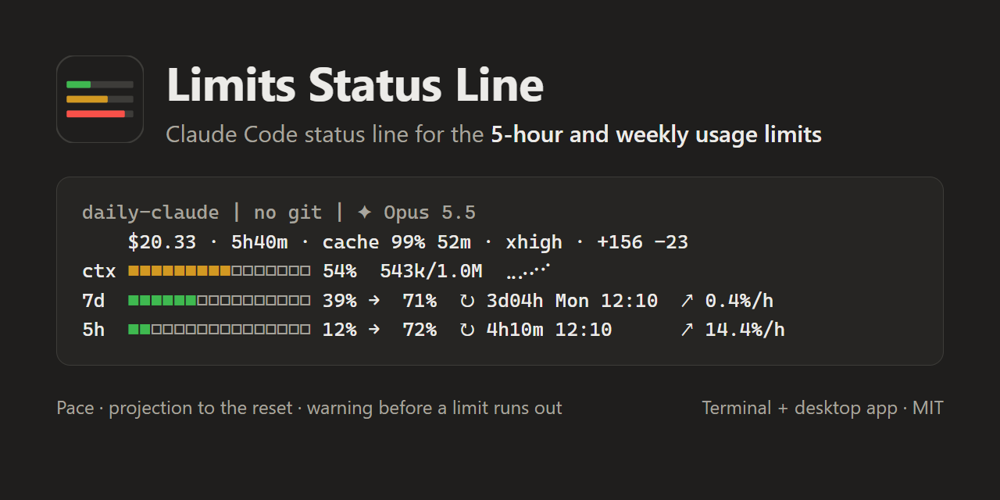

# Limits Status Line



A Claude Code status line plugin for your claude.ai plan's **5-hour and weekly usage limits**. It
answers, at a glance, "how close am I to my limits, and will I hit them before they reset?": for
the 5-hour and the weekly (7-day) limit it shows the usage now and where your current pace takes
it by the reset, the time and clock time of the reset, and the pace itself. When that pace would
pass 100% before the window resets, the limit turns red and says when it runs out. Next to the
limits it shows the session's cost, runtime, prompt-cache hit ratio and how long the cache stays
warm, effort and lines changed, the project, git branch and model, and how full the context
window is.

```
daily-claude | no git | ✦ Opus 5.5
    $20.33 · 5h40m · cache 99% 52m · xhigh · +156 -23
ctx ■■■■■■■■■□□□□□□□ 54%  543k/1.0M  ⣀⡠⠔⠊
7d  ■■■■■■□□□□□□□□□□ 39% →  71%  ↻ 3d04h Mon 12:10  ↗ 0.4%/h
5h  ■■□□□□□□□□□□□□□□ 12% →  72%  ↻ 4h10m 12:10      ↗ 14.4%/h
```

It works in both places Claude Code runs on your computer, on macOS, Linux and Windows alike:

- **Terminal** — the classic status line at the bottom of the screen; the context history is a
  braille line.
- **Claude desktop app (Code tab)** — a band above the prompt, drawn by the plugin's mod in the
  app's monospaced face, with the context history as a real vector line.

It is a Claude Code plugin only: claude.ai chat and Cowork have no status line, so it adds nothing
there.

## Requirements

| Feature | Needs |
|---|---|
| Operating system | One that [Claude Code supports](https://code.claude.com/docs/en/setup#system-requirements): macOS 13+, Windows 10 1809+ or Linux. The automated tests run on macOS, Linux (Ubuntu) and Windows ([Tests workflow](.github/workflows/tests.yml)) |
| Terminal status line | Claude Code with status line support and **Node.js 20+** on `PATH` (on macOS, for example, from [nodejs.org](https://nodejs.org/en/download), Homebrew or nvm) |
| Branch in the header | `git` on `PATH`; on macOS it comes with the Xcode Command Line Tools (`xcode-select --install`). Without it the terminal line says `no git` |
| Desktop band | Claude Code 2.1.290 or later (the desktop app updates its own copy); the monospaced face from 2.1.299. No Node.js needed |
| Weekly (7-day) and 5-hour limits | A claude.ai Pro or Max subscription; the limits appear after the session's first response |
| Prompt-cache ratio in the terminal | Exact with Claude Code 2.1.251+, estimated from the last request on older versions |

## Install

Install it from one source only, Anthropic's directory or GitHub, so that one copy draws the line.

### From Anthropic's directory

Once the plugin is listed in [Anthropic's directory](https://claude.ai/directory), add **Limits
Status Line** in claude.ai under **Customize → Plugins**, or browse the directory with
`/plugin directory` in Claude Code 2.1.287 or later. Claude Code loads it at the next session start
as `limits-statusline@synced`.

### From GitHub

From a shell, on any Claude Code version with plugins:

```bash
claude plugin marketplace add reylukakozlowski/limits-statusline
claude plugin install limits-statusline@sealoop
```

Newer versions can do both steps in one line: `/plugin install limits-statusline --marketplace
reylukakozlowski/limits-statusline` inside a session (Claude Code 2.1.275+), or
`claude plugin install limits-statusline --marketplace reylukakozlowski/limits-statusline` from a
shell (2.1.292+). In the desktop app: click **+** next to the prompt box, then **Plugins**,
**Add marketplace** with `reylukakozlowski/limits-statusline`, then add **limits-statusline**.

### Turn on the terminal status line

A plugin cannot switch the status line on by itself, so run this once in Claude Code:

```
/limits-statusline:setup
```

It writes `statusLine` into your `settings.json` (in `CLAUDE_CONFIG_DIR` when you set one, else
`~/.claude`). Your previous status line, if you had one, is saved and comes back with
`/limits-statusline:setup --uninstall`. Add `--dry-run` to see what would change without writing
anything. The command runs only when you type it, and Claude Code pre-approves only the plugin's
own setup script for it. The desktop band needs no setup.

### Uninstall

Run `/limits-statusline:setup --uninstall` **before** removing the plugin: it puts your previous
status line back (or removes the entry). Then remove the plugin where you added it: in claude.ai
under **Customize → Plugins** for the directory, or with
`claude plugin uninstall limits-statusline@sealoop` for GitHub. Removing or disabling the plugin
first leaves `settings.json` pointing at a runtime that no longer exists, so the bottom line goes
blank; your saved status line is still in `~/.claude/limits-statusline/previous-statusline.json`
and the command above restores it as long as the plugin is installed.

## Use cases

1. **Turn the status line on, after a look at what changes.** Type
   `/limits-statusline:setup --dry-run`: it prints the `statusLine` command it would write and
   writes nothing. Then type `/limits-statusline:setup`: it writes the entry, saves the status line
   you had, and the five lines appear at the bottom of the terminal after your next message.
2. **See whether the 5-hour limit runs out before it resets.** Work as usual and read the `5h`
   line:

   ```
   5h  ■■■■■■■■■■■□□□□□ 70% → 117%  ↻ 2h00m 16:20      ↗ 23.3%/h  ⚠ 100% in 1h17m
   ```

   Over the last half hour you used 23.3% an hour. At that pace the two hours left until the
   reset at 16:20 add about 47%, so the window would end near 117%: the line is red, and the
   limit runs out in 1h17m, well before the reset. That is the moment to switch to a smaller
   model or a lower effort, or to plan the rest of the work around the reset. Slow down and the
   pace, the projection and the colour follow within half an hour. Below 80% projected the line
   is green, from 80% to 100% yellow.
3. **Keep the context window in view during a long session.** The `ctx` bar shows how full the
   context window is, with the tokens used and the window size (`543k/1.0M`), and the line next to
   it shows how it moved. When the bar turns red (above 80%), `/compact` or `/clear` before
   Claude Code compacts on its own.
4. **Put your old status line back.** Type `/limits-statusline:setup --uninstall`: it restores the
   status line you had before setup, or removes the entry if you had none.
5. **Choose where the band appears.** Open `/config` (or the plugin's settings in the desktop app)
   and set `band` to `all` to draw the band in the terminal too, or to `off` to keep only the status
   line at the bottom.

## What the numbers mean

| Item | Source | Meaning |
|---|---|---|
| `$20.33` | `cost.total_cost_usd` | Session cost estimated by Claude Code at list price; resets on `/clear` |
| `5h40m` | `cost.total_duration_ms` | How long the session has been running (desktop: since the session first started) |
| `cache 99%` | `prompt_cache.hit_ratio` | Share of input tokens served from the prompt cache |
| `52m` / `cold` | `prompt_cache.expires_at` | How long the prompt cache stays warm without a new prompt (yellow in its last 5 minutes), or that it went cold and the next prompt rebuilds it |
| `xhigh` | `effort.level` | Reasoning effort of the session (desktop: shown after the first request) |
| `+156 -23` | `cost.total_lines_added`, `total_lines_removed` | Lines of code added and removed in the session (terminal only) |
| `ctx 54% 543k/1.0M` | `context_window` | Context window fill; the line shows how it moved during the session |
| `7d` / `5h` | `rate_limits` | The weekly (7-day) and 5-hour plan limits: usage now `→` projected at the reset, `↻` time and clock time of the reset, `↗` pace, `⚠` when the limit runs out before the reset |

**Pace** is how fast the usage grew recently, shown per hour: over the last **30 minutes** for the
5-hour limit and over the last **24 hours** for the 7-day limit, so the 7-day pace includes your
nights and days off. The **projection** (`→`) extends that pace to the reset:
it answers "where do I end up if I keep going like this?". The plan's limits are shared by every
session and by claude.ai, so the pace counts all of them: each session adds the figures it
receives to a small shared history, and the line always shows the newest figure any session saw.
Without readings from before it, a new window has no pace in its first 15 minutes (`→ —`,
`↗ —`); when you work on across a reset, the pace carries on from the previous window. Without
any history yet the pace is the average since the window opened. A large drop within a window is
taken as a limit reset given on claude.ai, and usage counts again from there.

Colours: green below 80% projected, yellow from 80% to 100%, **red above 100%** or when the limit
is used up; then `⚠ 100% in 1h17m` says when it runs out at the current pace. The reset's clock
time is in your computer's time zone, with the weekday when it is more than a day away. On a
narrow screen the clock time goes first, then the `⚠` part. The context bar is green below 50%,
orange to 80% and red above. The context line is scaled from its lowest to its highest point, so
it shows the shape of the trend; the percentage next to the bar is the absolute figure.

In the desktop app the cache countdown is estimated: Claude Code keeps the cache warm for an hour
after the last response on a plan within its limits and five minutes otherwise, unless
`promptCacheTtl` or a prompt-cache variable says else. Lines changed are shown in the terminal
only, because the desktop app does not give plugins that count.

## Settings

| Option | Values | Default |
|---|---|---|
| `band` | `desktop` (band only in the desktop app), `all` (also in the terminal), `off` | `desktop` |

Change it in `/config` or in the plugin's settings in the desktop app. Set `NO_COLOR=1` to print
the terminal status line without colours.

## Privacy: what the plugin runs, reads and writes

Everything stays on your computer. The plugin makes no network requests, sends no telemetry, uses
no credentials, and stores no prompts or responses. The only file contents it keeps are the
backup copy of your `settings.json` that setup makes. Folder paths and branch names, which it
reads and shows, can contain your name; [PRIVACY.md](PRIVACY.md) has the full statement.

Its data folder is `~/.claude/plugins/data/limits-statusline-<source>/`: `-synced` when you added
it from the directory, `-sealoop` when you added it from GitHub.

- **Status line** (terminal): reads the JSON Claude Code passes on stdin, runs
  `git status --porcelain=v2 --branch --untracked-files=no` in the working folder (with
  `GIT_OPTIONAL_LOCKS=0`, so it never takes git's index lock), and keeps a small context history per
  session, the fill percentages only, in the data folder's `history/` (pruned after 7 days).
- **Plan limit history** (status line and desktop band alike): the 5-hour and 7-day percentages
  with their time and reset time, and each session's last figures, in
  `~/.claude/limits-statusline/limit-history.json`, kept for 1 hour (5-hour) and 48 hours
  (7-day). A figure a session reports for the first time may be an old one, so the status line
  stamps it with the time the session's transcript was last written (the file's time only, never
  its contents).
- **Setup** (`/limits-statusline:setup`): copies the status line runtime (the plugin's own
  `src/core` and `src/terminal`) into the data folder, because the plugin's install folder changes
  with every update and the command in `settings.json` must not. It writes `statusLine` to
  `settings.json` (atomically, through a symlink if it is one) as `node` running that copy, and
  keeps your previous status line and a copy of the previous `settings.json` in
  `~/.claude/limits-statusline/`. It refuses to touch a settings file that is not valid JSON.
- **SessionStart hook**: after setup has run, refreshes the runtime copy after a plugin update and
  rebuilds it if it went missing; before setup it does nothing. On a computer without Node.js it
  cannot run and ends without an error, so sessions start as usual.
- **Desktop band** (mod): reads the session's figures from Claude Code, runs the same `git status`
  (or reads `.git/HEAD` where commands are unavailable), reads the `promptCacheTtl` setting and
  the prompt-cache variables, keeps the effort, cache counts, time of the last response, context
  history and git state in the state Claude Code holds for the mod, and redraws once a minute so
  the reset countdowns stay current.
  - **The one program it runs** is `git status --porcelain=v2 --branch --untracked-files=no`, in
    the session's folder with `GIT_OPTIONAL_LOCKS=0`, written out in full in
    `src/desktop/band.mjs`. It only reads the repository, to show the branch and whether there are
    uncommitted changes. Its output is read on your computer and goes nowhere else.
  - **The one file it writes** is the plan limit history above,
    `~/.claude/limits-statusline/limit-history.json` (in `CLAUDE_CONFIG_DIR` when set): the
    plugin's own data, which no other tool runs or reads as settings or instructions. It reads
    `CLAUDE_CONFIG_DIR`, `USERPROFILE` and `HOME` only to find that folder.
  - **It sends nothing anywhere**: no network requests, and nothing from the conversation leaves
    your computer. What it reads is drawn in the band and kept as described here.

With `CLAUDE_CONFIG_DIR` set, these folders live there instead of `~/.claude`.

## Troubleshooting

- **Nothing shows in a new session** — the plugin is not installed: `claude --plugin-dir` and a
  session's hot-reloaded mods folder load it for that session only. `claude plugin list` should
  show `limits-statusline@synced` or `limits-statusline@sealoop`; if it does not, follow
  [Install](#install).
- **The terminal shows nothing** — run `/limits-statusline:setup` and check that `node --version`
  prints 20 or higher. Claude Code runs the command through `sh` on macOS and Linux, and through
  Git Bash or PowerShell on Windows; its paths use forward slashes, which all of them read.
- **macOS asks to install the command line developer tools** — until they are installed,
  macOS's own `git` is only a stand-in that asks for them each time it runs, and the plugin runs
  `git status` to show the branch. Install them from that dialog or with `xcode-select --install`;
  the desktop app's isolated sessions need git as well.
- **The bottom line went blank after the plugin was removed or moved to another source** — run
  `/limits-statusline:setup` again with the plugin installed: it rebuilds the runtime copy and
  points `settings.json` at it, or use `--uninstall` to put your previous status line back.
- **`7d —` and `5h —`** — the limits arrive with the first response of a session and only for
  Pro and Max subscribers.
- **The 7-day projection is very high on the first day after installing** — the 7-day pace looks
  back 24 hours; until the shared history covers a day, the pace is the average since the weekly
  reset, which early in the week counts only working hours. It settles once a day of history is
  there.
- **Odd pace after switching accounts** — the shared history does not tell accounts apart; two
  accounts used in turn within a week mix their figures until the readings age out (48 hours).
- **No effort or cache shown** — older Claude Code versions do not send them; update Claude Code.

## Support

- Questions, bugs and ideas: [GitHub issues](https://github.com/reylukakozlowski/limits-statusline/issues).
- Security problems: report them privately as [SECURITY.md](SECURITY.md) describes, not in a
  public issue.
- Contact: Luka Kozlowski (SeaLoop), lukakozlowski@sealoop.com.

## Development

Tests, running a working copy in every session, and releases are described in
[CONTRIBUTING.md](CONTRIBUTING.md).

## License

MIT © 2026 Luka Kozlowski (SeaLoop) · lukakozlowski@sealoop.com
